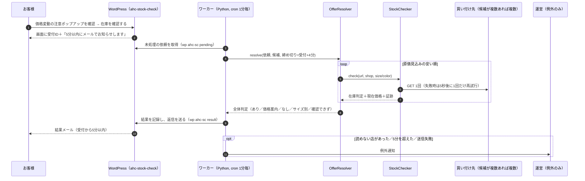

# 在庫確認フロー 最終設計（Claude、2026-11-21）

> **superseded（2026-11-21 12:32頃のオーナー決定：メール返信を廃止し、その場で判定してカートへ）**：現行は docs/stock-check-inline-final-design-claude-2026-11-21.md。

**この文書が在庫確認フローの設計の正本。** 旧設計 v2／v2.1（docs/stock-check-auto-flow-design-v2-claude-2026-11-20.md）は superseded。

根拠：
- オーナー決定（docs/stockcheck-addendum-2026-11-21.md）
  - §1 価格の伝え方
  - §2 複数買い付け先
  - §4 決定1 現在価格を読む
  - §4 決定2 価格差400円ルール
  - §4 決定3 読めない場合は説明して再確認をお願いする
  - パラメータ確定
- オーナー確定事項
  - 結果返信は5分以内
  - 在庫確認をしないと買えない

実装は GPT（チェックリスト：docs/stockcheck-decision3-implementation-handoff-gpt-2026-11-21.md）。作業場所は XServer で、Local には反映しない。

## 0. 旧設計から外したもの（決定3）
- 1時間後・6時間後の自動再試行
- 「確認中」のまま保持する仕組みと「確認中」メール
- 24時間後の連絡の約束と、24時間後の例外通知
- 自動期限切れ（14日／48時間とも設けない）
- 運営宛の新着通知メール
- 受付メール（受付IDは画面に出し、結果メールを5分以内に送る）
- 管理画面での手動の状態変更を前提にした運用
- 30秒後の再試行（数秒の即時再試行だけ残す）

## 1. 流れ

- ワーカーは cron で1分ごとに起動する。
  - 見るのは自サイトの未処理依頼だけ。買い付け先の巡回はしない。
  - 依頼1件につき、買い付け先1店あたり原則1回取得する。
- 締め切りは「受付時刻＋4分」として依頼ごとに持つ。ワーカーが拾った時刻からは数えない。
  - 締め切りが来たら、その時点で分かっている結果で判定する（§3）。
  - これで受付から5分以内に送信できる。
- WP とのやり取りは WP-CLI で行う。外部公開の API は増やさない。
  - `wp ahc-sc pending`：処理対象を JSON で返す
  - `wp ahc-sc result <id> --json=…`：判定と記録を保存し、返信を送る

## 2. StockChecker（1店・1URLを見る部品）
```text
check(url, shop, variant: {size?, color?}, *, use_cache=True, now) -> CheckResult
CheckResult:
  stock:     IN_STOCK | OUT_OF_STOCK | UNCONFIRMED
  other_sizes_in_stock: list[str]   # 依頼サイズが品切れで、同じ色の他サイズに在庫がある場合
  current_price: {amount, currency} | None   # 在庫判定と同じページから読む（オーナー決定1）
  reason:    OK | NOT_FOUND_404 | GONE_410 | DISCONTINUED            # 確定
           | UNREACHABLE（接続失敗・タイムアウト・5xx）
           | BLOCKED（403・429・ボット確認画面）
           | UNREADABLE（取得できたが解析不能）
           | VARIANT_NOT_FOUND | PRICE_UNKNOWN
  http_status, fetched_at, cache_hit, parser（config:<shop>|fallback）, evidence（最大500字）
```
- **取得の作法**
  - 識別できる User-Agent を付ける。タイムアウト10秒。
  - 失敗したら5秒後に1回だけ再試行する。
  - BLOCKED の場合は再試行も回避もしない。その店には一定時間（初期値30分）、どの依頼からも照会しない。
- **確定とするもの**
  - 404・410・販売終了の表示 → 品切れ確定
  - 依頼サイズの在庫あり／なしが読めた → 確定
- **UNCONFIRMED（確定できない）とするもの**
  - 依頼サイズが特定できない
  - 在庫ありでも価格が読めない（販売価格を計算できないため）
- **キャッシュ**：IN_STOCK と OUT_OF_STOCK だけ、同じURLで30分使い回す。UNCONFIRMED は使い回さない。お客様がしばらくして再依頼したとき、ちゃんと取り直すため。
- **店ごとの設定**（セレクタ、在庫・価格の読み方、サイズ表記の対応表、キーワード）は GPT が実装時に用意する。設定で取れないときだけ、汎用のキーワード判定を使う。

## 3. OfferResolver（複数の買い付け先から全体の結果を決める）
1. 候補は照合v2の検収済みSKUに結び付いた買い付け先だけ。原価見込みの安い順に並べる。見込みが無い店は最後に回す。推測で候補を足さない。
2. 順に照会する。UNCONFIRMED の店は飛ばして次へ進む。
3. 在庫ありの店ごとに、読んだ現在価格で原価と販売価格を計算し直す。計算式はオーナー確定の価格ルール（GPT 側の既存関数）。
4. 照会を早めに打ち切れる場合
   - 計算し直した販売価格が掲載価格以下の店が見つかったら、それより得になる店は無いので、残りの店は見ない。
   - それ以外は、締め切りまで残りの店を照会する。
5. **採用**：在庫ありの店の中で、計算し直した販売価格が最も安い店（オーナー決定2）。
   - 差＝計算し直した販売価格−掲載価格。
   - 差が400円未満（安い場合を含む）→ **あり**。掲載価格のまま。
   - 差が400円以上 → **価格案内**。現在価格を案内する。
   - 400円は設定値 `price_tolerance_jpy`。
6. 採用店が無い場合
   - 全店が品切れ確定 → **なし**。ただし、ある店に他サイズの在庫があれば **サイズ別**。
   - それ以外（UNCONFIRMED が残る／締め切り／候補ゼロ）→ **確認できず**。
     - 品切れと言い切らない。一部の店が品切れ確定でも同じ扱い。
- 表示中の販売価格は書き換えない。
- カタログ整理フラグは、全店が品切れ確定のときだけ付ける。

## 4. WordPress 側（ahc-stock-check.php の変更点）
| 状態 | 意味 | 終わりかどうか |
|---|---|---|
| received（受付） | 受付直後 | 処理中 |
| checking（確認中） | ワーカーが処理している最中だけ（数分） | 処理中 |
| available（確保可） | あり、または価格案内（price_case=LISTED/QUOTE を記録） | 終わり |
| unavailable（確保不可） | なし、またはサイズ別 | 終わり |
| unconfirmed（確認できず）**新設** | 確認できず | 終わり |
| cancelled（取消） | 既存のまま | 終わり |

- **重複防止**：「受付」「確認中」の間だけ。終わった依頼があっても、新しい依頼は受け付ける。
- **自動期限切れ**：設けない。`intake_expired` 状態と、その日次処理は削除する。
- **保持期間**：終わってから90日で削除（`retention_months` を日数の `retention_days=90` に置き換える）。管理画面からの削除はそのまま残す。
- **5分の見張り**：受付から5分たっても「受付」「確認中」のままの依頼があれば、運営へ通知する（ワーカー停止などの故障）。
  - その依頼は遅れても処理して返信を送る。返信しないままにはしない。
- **削除するもの**
  - 運営宛の新着通知メール、受付メール
  - 管理画面の「確認中のまま手動メール」説明文
- **フォームの文言**：「通常3営業日以内に返信」→「確認結果は5分以内にメールでお知らせします」
- **価格変動の説明**（決定§1、サイト側）
  - サイトの常設ページ「取引の注意事項」に、次の5つの事案を書く。
    1. 別の店で買う場合
    2. クーポンの失効・条件変更
    3. セール終了
    4. 為替が想定（158円×1.02）を超えた場合
    5. 買い付け先の値上げ
  - 在庫確認ボタンを押したとき、ポップアップで同じ内容を短く出してから、フォームを開く。
- **プライバシーポリシー**：保持の表記を「90日」にする。
- 管理画面は閲覧用。状態の手動変更は残すが、判定に人の操作は要らない。

## 5. 返信テンプレート（5種）
共通の差し込み：{name} {receipt_id} {product} {color} {size} {checked_at}
- 価格変動の注意は書かない（決定§1）。
- 在庫の確保を約束しない一文は書く。これは価格の注意ではない。

**あり**
> 件名：【AFTER HOURS CLUB】在庫確認の結果：在庫あり（{receipt_id}）
> {name} 様
> ご依頼の商品について、{checked_at} 時点で買い付け先に在庫があることを確認しました。
> 商品：{product} / カラー：{color} / サイズ：{size}　販売価格：{listed_price}
> 購入手続きのご案内は、別途お送りします。
> 在庫は変動するため、この確認は商品の確保をお約束するものではありません。この時点では注文・決済は発生していません。

**価格案内**（差が400円以上）
> 件名：【AFTER HOURS CLUB】在庫確認の結果：在庫あり・価格のご案内（{receipt_id}）
> {name} 様
> ご依頼の商品について、{checked_at} 時点で買い付け先に在庫があることを確認しました。
> 商品：{product} / カラー：{color} / サイズ：{size}
> 現在の買い付け条件では、販売価格は {quote_price}（掲載価格 {listed_price}）となります。この価格でのご購入をご検討ください。
> 購入手続きのご案内は、別途お送りします。
> 在庫は変動するため、この確認は商品の確保をお約束するものではありません。この時点では注文・決済は発生していません。

**なし**
> 件名：【AFTER HOURS CLUB】在庫確認の結果：在庫なし（{receipt_id}）
> {name} 様
> ご依頼の商品は、{checked_at} 時点で買い付け先に在庫がなく、ご用意できませんでした。
> 商品：{product} / カラー：{color} / サイズ：{size}
> ご依頼ありがとうございました。

**サイズ別**
> 件名：【AFTER HOURS CLUB】在庫確認の結果：ご指定サイズは在庫なし（{receipt_id}）
> {name} 様
> ご依頼のサイズ（{size}）は、{checked_at} 時点で買い付け先に在庫がありませんでした。
> 同じ商品・同じカラーでは、次のサイズに在庫がありました：{other_sizes}
> ご希望の場合は、商品ページからあらためて「在庫を確認する」をご利用ください。

**確認できず**（決定3。理由の一文だけ差し替える）
> 件名：【AFTER HOURS CLUB】在庫確認の結果：現在確認できませんでした（{receipt_id}）
> {name} 様
> ご依頼の商品（{product} / カラー：{color} / サイズ：{size}）の在庫を確認しようとしましたが、{reason_sentence}
> 在庫がないという意味ではありません。お手数ですが、時間をおいて、商品ページからもう一度「在庫を確認する」をご利用ください。

- {reason_sentence} の使い分け
  - UNREACHABLE／BLOCKED：「現在、買い付け先のサイトにつながらず、確認できませんでした。」
  - UNREADABLE／VARIANT_NOT_FOUND／PRICE_UNKNOWN：「現在、買い付け先のサイトで在庫情報を読み取れず、確認できませんでした。」
  - 締め切り：「買い付け先の確認に時間がかかり、時間内に確認できませんでした。」
  - 候補ゼロ（こちらのデータ不備）：「現在、この商品の在庫を確認できない状態です。」

## 6. 運営への通知（この3種だけ。それ以外は送らない）
1. **読めない店**：UNREACHABLE／BLOCKED／UNREADABLE／PRICE_UNKNOWN、または候補ゼロ。
   - 内容：店コード、URL、HTTP状態、証跡、時刻。
   - 同じ店については1時間に1回までにまとめる。
   - 取得方法の問題として、フローの外で直す（決定3）。
2. **5分超え**：受付から5分以内に送信できなかった依頼。
3. **送信失敗**：wp_mail が失敗した依頼。送信成功として扱わない。

## 7. 記録（依頼ごと。管理画面で見られる。保持は90日）
- 依頼ごと
  - 受付ID、受付時刻、送信時刻（受付から何秒か）、返信テンプレート、送信結果
  - 全体判定と理由、採用店、price_case
  - 読んだ現在価格（現地通貨）、計算し直した原価と販売価格、掲載価格、差
- 店ごとに1行
  - 順位、店、URL、原価見込み、在庫判定、現在価格、理由、http_status、証跡、取得時刻、キャッシュ利用の有無

## 8. E2E 自動テスト（mock の買い付け先で。人の工程ゼロ）
| # | mock | 期待 |
|---|---|---|
| 1 | 1店・依頼サイズ在庫あり・掲載価格以下 | あり、5分以内に送信 |
| 2 | 1店・全サイズ品切れ | なし＋カタログ整理フラグ |
| 3 | 1店・依頼サイズ品切れ・他サイズあり | サイズ別（他サイズの一覧が本文にある） |
| 4 | 1店・404 | なし |
| 5 | 1店・初回5xx→5秒後の再試行で在庫あり | あり（再試行1回が記録される） |
| 6 | 1店・タイムアウトが続く | 確認できず（つながらない文面）＋運営通知1件、遅延再試行のジョブは0件 |
| 7 | 1店・403 | 確認できず、取得1回のみ、その店は待ち時間に入る |
| 8 | 1店・解析不能 | 確認できず（読み取れない文面）＋運営通知 |
| 9 | 1店・在庫ありだが価格が読めない | 確認できず（PRICE_UNKNOWN） |
| 10 | 最安の店が品切れ、2番目が在庫ありで掲載価格以下 | あり、選んだ店＝2番目、3番目は照会しない |
| 11 | 1店は品切れ、1店は読めない | 確認できず（品切れとは返さない）、カタログ整理フラグなし |
| 12 | 全店品切れ | なし＋カタログ整理フラグ |
| 13 | 在庫ありの2店、差300円と900円 | 300円の店を選ぶ、あり（掲載価格） |
| 14 | 在庫ありの最安でも差が400円以上 | 価格案内、案内価格が本文にある |
| 15 | 差がちょうど400円 | 価格案内 |
| 16 | 遅い店が3つで締め切り超え | 受付から4分の時点で、確定分から判定（無ければ確認できず） |
| 17 | 候補ゼロ | 確認できず＋運営通知 |
| 18 | 同じURLの依頼2件を30分以内に処理 | 2件目はキャッシュを使う（mock へのアクセスは1回）。UNCONFIRMED は使い回さない |
| 19 | 「確認できず」のあとに同じ人が再依頼 | 新しい依頼として受け付ける |
| 20 | 処理中に同じ人が再依頼 | 重複として新規を作らない |
| 21 | ワーカー停止で受付から5分経過 | 5分超えの運営通知、復旧後に処理して返信 |
| 22 | 送信失敗 | 送信失敗の運営通知、送信成功として扱わない |
| 23 | 終わってから90日 | 削除される。89日では残る |
| 24 | 全ケース共通 | 返信に価格変動の注意文言が無い。運営宛は §6 の3種だけ。受付メールは送らない |

## 9. 着手前に確かめること（GPT・魔王ちゃん、XServer で）
1. **買い付け先の候補データ**：商品から照合v2の買い付け先URL・店コード・原価見込みを引ける形で保存されているか。
2. **価格の計算し直し**：現在価格から販売価格を出す既存関数を、OfferResolver から呼べるか。
3. **定期実行**：XServer の cron から Python と WP-CLI を1分ごとに動かせるか。WP-CLI が使えることは確認済み。
4. **メール**：XServer の wp_mail で送信できるか。迷惑メール扱いにならない送信元設定になっているか。

## 10. 未決（在庫確認フローの範囲外）
- 「あり」「価格案内」のあとの購入手続き：案内価格の了承の仕方、有効時間、購入直前の再照会。これは購入手続きの設計で決める。
