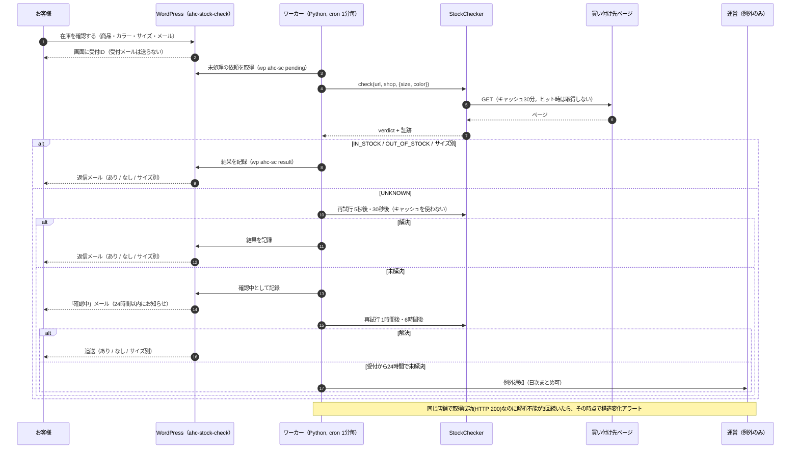

# 在庫確認フロー設計 v2（自動確認）— Claude、2026-11-20

根拠：オーナー決定 2026-11-20 20:22（docs/owner-decisions-2026-11-20-stockcheck-matching.md）、GLM判断 91c8ad4（docs/glm-decisions-stockcheck-matching-v2-2026-11-20.md §1）。
旧設計（docs/stock-check-flow-design-claude-2026-11-20.md、手動確認フロー）は superseded。
範囲は GLM §1-1〜1-4 のとおり。追加の機能提案はしない。実装は GPT が担当する。

## 0. 旧設計からの変更点
- **削除するもの**
  - 運営（オーナー）宛の新着通知メール（ahc-stock-check.php の `ahc_sc_send_mails` の notify 部分）
  - 管理画面での手動状態変更を前提にした運用（説明文・「確認中のまま手動メール」ルール）
  - Mailpit 目視確認ゲート
  - フォームの「通常3営業日以内に返信」表記（→「確認結果はメールでお知らせします」に変更）
- **残すもの**（段階1の資産）
  - 商品ページの「在庫を確認する」とフォーム
  - 受付・受付ID・重複防止・nonce/連投/ハニーポット
  - 非公開の依頼データ、受付期限切れ、保持期間削除、カート拒否
  - 管理画面の一覧（閲覧・ログ確認用。判定のための人の操作は無い）
- **追加するもの**
  - StockChecker（Python）
  - 自動判定 → 自動返信、UNKNOWN 時のリトライ・「確認中」即時返信・追送
  - 例外通知（UNKNOWN 24時間未解決、ページ構造変化）だけを運営へ送る

## 1. シーケンス

- 起動の仕組み：サーバーの cron が1分ごとにワーカーを起動する。ワーカーが見るのは自サイトの未処理依頼だけで、買い付け先を巡回しない。依頼1件につき、原則1回だけ取得する。
- WP とのやり取り：WP-CLI コマンドで行い、外部公開の API は増やさない。
  - `wp ahc-sc pending`：処理対象を JSON で返す
  - `wp ahc-sc result <id> --verdict=… --reply=…`：結果記録とメール送信
- 受付直後に画面とメールの両方を出すと二重になるため、受付メールは廃止する。画面の受付ID表示は残す。
  - 画面の文言：「確認結果はメールでお知らせします（通常数分以内）」

## 2. StockChecker インターフェース
```text
check(url: str, shop: str, variant: {size?: str, color?: str} | None,
      *, use_cache: bool = True, now: datetime) -> CheckResult

CheckResult:
  verdict:        "IN_STOCK" | "OUT_OF_STOCK" | "UNKNOWN"
                  （依頼サイズの判定。variant 指定なしなら商品全体の判定）
  other_sizes_in_stock: list[str]  # 依頼サイズが品切れで、同じ商品・同じカラーの他サイズに在庫がある場合のみ
  reason:         OK_CONFIG | OK_FALLBACK | NOT_FOUND_404 | GONE_410 | DISCONTINUED
                  | HTTP_ERROR | TIMEOUT | BLOCKED | PARSE_FAIL | VARIANT_NOT_FOUND | NO_URL
  http_status:    int | None
  fetched_at:     ISO8601（キャッシュヒット時は元の取得時刻）
  cache_hit:      bool
  parser:         "config:<shop>" | "fallback"
  evidence:       str  # 判定に使ったページの生テキスト断片（最大500字）
```

判定規則：
- **IN_STOCK**：依頼サイズ（とカラー）の在庫ありを、設定ファイルのセレクタまたは汎用キーワードで確定できたとき。
- **OUT_OF_STOCK**：次のどれかに当たるとき。
  - 依頼サイズの品切れを確定できた
  - 404 / 410（販売終了＝確定情報として扱う）
  - 販売終了の文言がある
- **UNKNOWN**：上記以外。たとえば次の場合。
  - 5xx、タイムアウト
  - 403 / 429 / ボット確認画面（BLOCKED。回避はしない）
  - 解析不能
  - 商品全体の在庫は分かるが、依頼サイズが特定できない（VARIANT_NOT_FOUND。「あり」とは返さない）
  - 買い付け先URLが無い（NO_URL）
- 取得の作法：識別できる User-Agent を付ける。タイムアウト10秒。依頼1件につき原則1回取得。
- キャッシュ：同じURLの結果を30分保持する。再試行のときはキャッシュを使わない。
- 店舗別設定（例：config/stockcheck/<shop>.yaml）。値は GPT が実装時に、mock ページのテストと一緒に用意する。
  - 商品ページ判定のセレクタ
  - バリエーション（サイズ・カラー）の取り出し方と、サイズ表記の対応表
  - 在庫あり／品切れ／販売終了のキーワード
- 汎用フォールバック：設定で取れないときだけ、ページ全文のキーワードで判定する。サイズを特定できなければ UNKNOWN。
- 例外通知の条件は2つだけ。
  - UNKNOWN が受付から24時間未解決
  - 構造変化：同じ店舗で HTTP 200 なのに PARSE_FAIL が3回連続

## 3. WordPress 側の状態と記録
| 状態（既存キー） | 意味 | 返信 |
|---|---|---|
| received（受付） | 受付直後 | なし（画面に受付ID） |
| checking（確認中） | ワーカー処理中、または UNKNOWN 再試行中 | UNKNOWN が30秒で解決しなければ「確認中」 |
| available（確保可） | IN_STOCK | 「あり」 |
| unavailable（確保不可） | OUT_OF_STOCK | 「なし」または「サイズ別」 |
| intake_expired / cancelled | 既存のまま | なし |

ログ（依頼ごとに保存し、管理画面で閲覧できる）：
- `inquiry_id`（受付ID）
- 照合SKU
- 判定、reason
- 返信テンプレ名と送信結果
- 証跡（evidence・取得時刻・http_status）
- 再試行の回数と時刻
- OUT_OF_STOCK のときはカタログ整理フラグ `_ahc_sc_catalog_flag=1` を付ける（商品データは変えない）

## 4. 返信テンプレート（4種）
共通の差し込み：{name} {receipt_id} {product} {color} {size} {price}（受付時の表示価格） {checked_at}（確認日時）

**あり（IN_STOCK）**
> 件名：【AFTER HOURS CLUB】在庫確認の結果：在庫あり（{receipt_id}）
> {name} 様
> ご依頼の商品について、{checked_at} 時点で買い付け先に在庫があることを確認しました。
> 商品：{product} / カラー：{color} / サイズ：{size}
> 表示価格：{price}
> 海外ショップの在庫・価格は変動するため、この確認は商品の確保をお約束するものではありません。
> 購入手続きのご案内は、別途メールでお送りします。
> この時点では注文・決済は発生していません。

**なし（OUT_OF_STOCK）**
> 件名：【AFTER HOURS CLUB】在庫確認の結果：在庫なし（{receipt_id}）
> {name} 様
> ご依頼の商品は、{checked_at} 時点で買い付け先に在庫がなく、ご用意できませんでした。
> 商品：{product} / カラー：{color} / サイズ：{size}
> ご依頼ありがとうございました。

**サイズ別（依頼サイズは品切れ、他サイズに在庫あり）**
> 件名：【AFTER HOURS CLUB】在庫確認の結果：ご指定サイズは在庫なし（{receipt_id}）
> {name} 様
> ご依頼のサイズ（{size}）は、{checked_at} 時点で買い付け先に在庫がありませんでした。
> 同じ商品・同じカラーでは、次のサイズに在庫がありました：{other_sizes}
> ご希望の場合は、商品ページからあらためて「在庫を確認する」をご利用ください。
> 在庫は変動するため、確保をお約束するものではありません。

**確認中（UNKNOWN が30秒で未解決）**
> 件名：【AFTER HOURS CLUB】在庫確認を受け付けました：確認中（{receipt_id}）
> {name} 様
> ご依頼の商品の在庫を確認しています。結果は24時間以内にメールでお知らせします。
> 商品：{product} / カラー：{color} / サイズ：{size}
> この時点では注文・決済は発生していません。

## 5. E2E 自動テスト仕様（人の工程ゼロ）
実行方法：
- ローカル HTTP サーバーで mock の買い付け先ページを出す。
- 問い合わせ投入 → ワーカー実行 → 送信メールを捕捉する。
- メールの捕捉は wp_mail のフック、または Mailpit API。目視はしない。
- 時刻は注入できるようにし、再試行の待ち時間を短縮する。

| # | mock | 期待される判定 | 期待される返信 | 期待される状態・記録 |
|---|---|---|---|---|
| 1 | 依頼サイズ在庫あり | IN_STOCK / OK_CONFIG | あり | available、証跡あり |
| 2 | 全サイズ品切れ | OUT_OF_STOCK | なし | unavailable、catalog_flag=1 |
| 3 | 依頼サイズ品切れ・他サイズあり | OUT_OF_STOCK + other_sizes | サイズ別（他サイズ一覧が本文にある） | unavailable |
| 4 | 404 | OUT_OF_STOCK / NOT_FOUND_404 | なし | unavailable、catalog_flag=1 |
| 5 | 解析不能 → 5秒後の再試行で在庫ありに変わる | IN_STOCK | あり（確認中は送らない） | 再試行1回が記録される |
| 6 | 常に解析不能 | UNKNOWN | 確認中 → 24時間で例外通知1件 | checking、再試行4回（5s/30s/1h/6h）が記録される |
| 7 | 6の途中（1時間後）で在庫ありに変わる | IN_STOCK | 確認中 → 追送「あり」 | available |
| 8 | 503 / タイムアウト | UNKNOWN / HTTP_ERROR・TIMEOUT | 6と同じ経路 | — |
| 9 | 403 / ボット確認画面 | UNKNOWN / BLOCKED | 6と同じ経路、回避の試行なし | 取得1回のみ |
| 10 | 同じ店舗で HTTP 200 の解析不能が3件続く | — | 構造変化アラート1件 | — |
| 11 | 同じURLの依頼2件を30分以内に処理 | 2件目は cache_hit=true | それぞれに返信 | mock へのアクセスは1回 |
| 12 | 商品全体は在庫ありだが依頼サイズが見つからない | UNKNOWN / VARIANT_NOT_FOUND | 「あり」は送らない | — |
| 13 | 買い付け先URLなし | UNKNOWN / NO_URL | 6と同じ経路 | — |
| 14 | 全ケース共通 | — | 運営宛メールは #6・#10 の例外だけ | ログ項目の欠けなし |

合格条件：14件すべてが自動アサーションで PASS。

## 6. 着手前に確認が要る前提（GPT・魔王ちゃん）
1. **買い付け先URLの保存場所**：Local の現行商品で、買い付け先URL（と店舗コード）がどの meta に入っているか。研究用の出力では `_nexus_source_url` を使っているが、現行 Local は未確認。無い商品は NO_URL → UNKNOWN になる。
2. **cron と WP-CLI の可否**：Python と WP-CLI を cron から動かせるか。Local と本番（XServer 移行先）の両方で確認する。

## 7. GLM に判断してほしい点（設計の穴）
1. **「あり」返信の次の手順**：購入リンク（旧段階2）と決済が未実装のため、「購入手続きのご案内は別途」と書くと人の作業が残る。この期間の扱いをどうするか。
2. **24時間未解決のときのお客様への連絡**：「確認中」で24時間以内の連絡を約束している。一方、テンプレは4種に限られ、24時間時点でお客様へ送る文面が無い。例外通知を受けた運営が返す前提でよいか。
